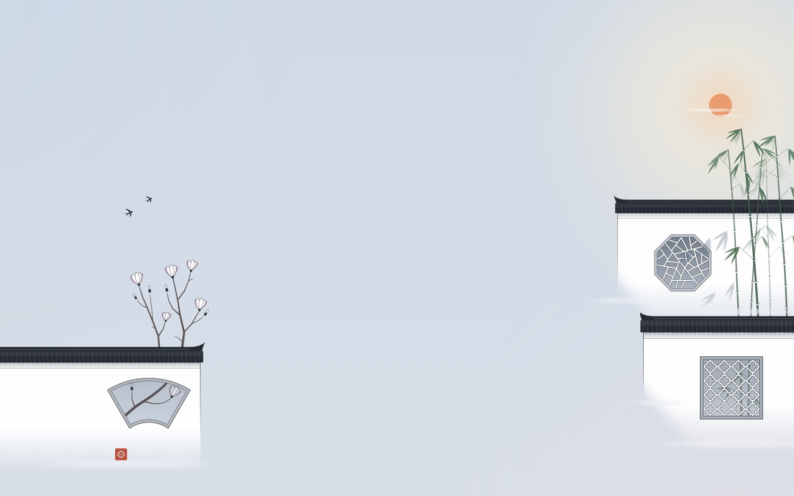
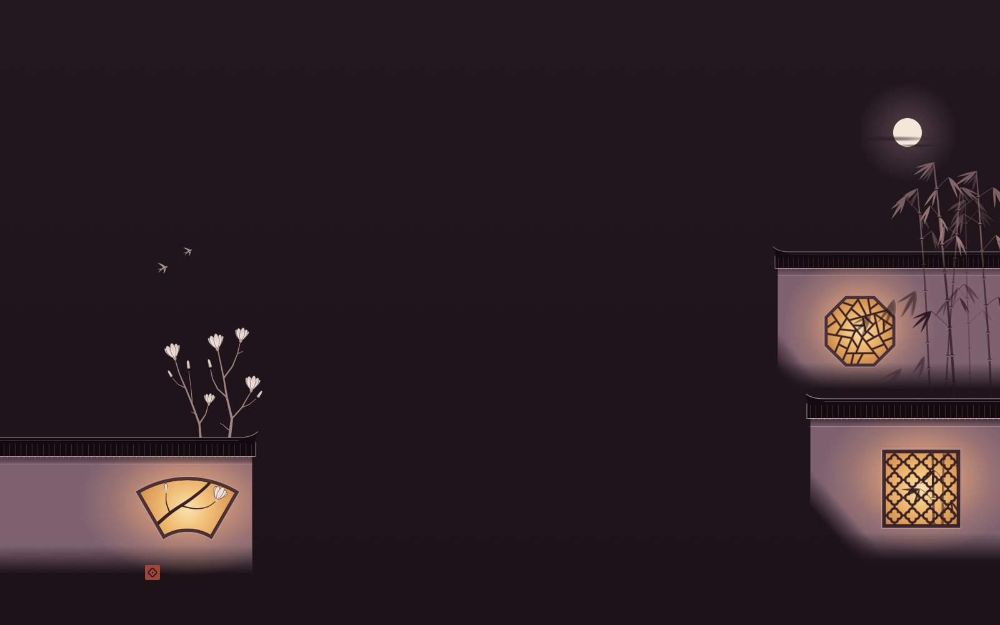

# claude-mods

给 Claude 桌面 app 换对话背景的 mod：一面苏州园林的粉墙黛瓦，跟随系统深浅自动切换。
A wallpaper mod for the Claude desktop app: a Suzhou garden wall that follows the system's light or dark appearance.

| 浅色 · 晴日写真 | 深色 · 灯影夜游 |
| --- | --- |
|  |  |

## 安装 / Install

```
/plugin install theme-examples --marketplace Justaboringname/claude-mods
```

装好后每个会话默认显示「花窗」。`/custom-theme` 出卡片可以换别的主题，`/custom-theme off` 关掉默认壁纸，`/custom-theme default` 再打开。

After installing, every session shows Lattice Windows by default. `/custom-theme` lists the other themes, `/custom-theme off`
turns the default off, `/custom-theme default` turns it on again.

## 里面有什么 / What is here

- `theme-examples/`：mod 本体。它是 Anthropic 官方 `theme-examples` 0.4.3 的改版（Apache-2.0），改动见该目录的 README。
  跟随系统深浅这一项只支持 macOS（Apple 芯片）。
- `_workshop/`：画场景的草稿、考证笔记和检查工具，见 `_workshop/README.md`。
- `.claude-plugin/marketplace.json`：让这个仓库可以当作插件市场来安装。

`theme-examples/` is the mod: Anthropic's `theme-examples` 0.4.3 with local changes (listed in its README). Following the
system's appearance works on macOS (Apple silicon) only. `_workshop/` holds scene drafts, research notes and the checking tools.

这个改版沿用了官方插件的名字，所以不能和官方的 `theme-examples` 同时安装。
This build keeps the original plugin's name, so it cannot be installed beside Anthropic's own `theme-examples`.

## 许可 / License

Apache License 2.0，见 `LICENSE` 和 `NOTICE`。
